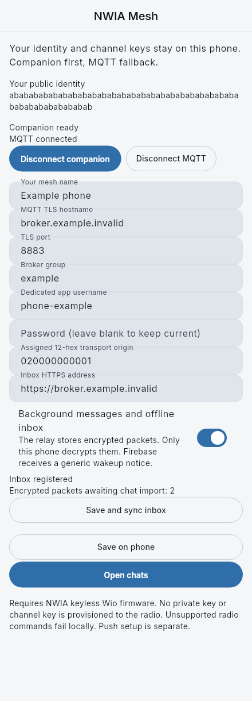

# NWIA Mesh: phone-owned keys, keyless radio, MQTT and inbox

The Android fork owns its MeshCore identity and channel keys in a Keystore-wrapped
phone vault. The Wio Tracker L1/L1 Pro is an opaque BLE/LoRa modem, including while
powered on: no message keys, plaintext chat or broker credentials are provisioned
to it. The full-packet Heltec gateways continue native local repeating independently
of internet availability. iOS and production signing are later work.

## Message routing

Prefer a ready companion. A direct message falls back once to TLS MQTT after a
failed transmission, disconnection or native recipient-ACK timeout. The same
ciphertext and original native timestamp are reused. Channel chat uses MQTT only
when the companion is unavailable or RF transmission fails; successful channel
RF transmission has no recipient ACK to wait for. MQTT write completion is not
recipient delivery. Native short receipts are not signed read receipts.

The Android endpoint terminates the existing UI's stock command frames on the
phone. Only the NWA1 modem handshake and opaque native packets reach BLE. Private
key import/export, plaintext legacy DM commands, login and unsupported radio
settings fail locally. Native crypto/delivery policy has one owner; upstream
legacy retries must not re-encrypt or resend NWIA messages in parallel.

## Background messages and offline inbox

The separate [relay](../server/README.md) reads the existing MQTT packet stream
with a read-only account. It retains encrypted chat candidates for 72 hours, with
per-phone bounds and visible expiry/overflow counts. It does not possess mesh
private/channel keys. Firebase receives only a generic inbox wakeup notice.
Android WorkManager authenticates HTTPS requests with the phone identity,
atomically caches encrypted packets, then acknowledges the server cursor.

Open NWIA controls, set the **Inbox HTTPS address**, enable **Background messages
and offline inbox**, then choose **Save and sync inbox**. Initial registration
also checks the phone's separate MQTT credentials and its operator-approved
username/group/origin binding. The first full public identity is locked to that
binding. The status must become **Inbox registered**. A fresh installation needs
its own broker account; do not reuse a gateway account or another phone's origin.

On reopening, the phone decrypts retained packets using their authenticated
original capture time and imports them into the same chat history. It removes a
local cached packet only after history persistence succeeds. Native paths are
excluded from dedup IDs. Recovery never republishes old chat packets onto LoRa;
a freshly decrypted direct message may return its normal short receipt through
the phone's MQTT account. No channel-recipient receipt is invented.

Native destinations/channel hashes are one byte, so candidate fanout and unknown
keys are expected. The phone checks the MAC/format before notifying. Unknown-key
candidates have a separate bounded allowance; a full readable cache stops server
ACKs until history is imported. Full sender public keys must be known in the
phone's contact book. See the relay guide for precise limits and transfer rules.

Push is best-effort. Opening the app or periodic background sync recovers missed
wakeups. Android **Force stop** blocks background delivery until manually opening
the app again. Ordinary backgrounding/process termination is supported. Inbox
collection begins at registration, not before opting in. Disabling collection
requests deletion of the server queue when reachable; existing on-phone chat and
cached data are retained. The server cannot recover a lost phone private key.

## Setup and build

Flutter 3.47.9 is pinned by the base project. For an FCM-enabled local build,
place the matching Android client configuration at
`android/app/google-services.json`; it is ignored by Git. Service-account sender
keys belong only on the server. No real MQTT/Wi-Fi password, private channel key,
private mesh identity or production signing key is in the source or firmware.
The standard publicly known MeshCore Public channel default remains available.

```sh
flutter pub get
flutter gen-l10n
flutter analyze --fatal-infos --fatal-warnings
flutter test
flutter build apk --debug --target-platform android-arm64
python3 tools/verify_nwia_debug_apk.py build/app/outputs/flutter-apk/app-debug.apk
cd android && ./gradlew :nwia-core:verifyCore
```

Verify the APK signer matches the installed pilot and update **without uninstalling
or clearing app data**. The app ID, vault alias/format and existing identity are
preserved. The Wio overlay and pinned build instructions are under
[`firmware/nwia-keyless`](../firmware/nwia-keyless/README.md). Original MIT notices
remain; see [native components](nwia-third-party.md).

Example UI (fixture values, not deployment credentials):



## Recorded validation

The previous Android integration passed 1,548 Flutter tests and 127,719 native
policy/crypto/framing/bounds checks. The physical phone retained its original
encrypted identity and public identity across in-place updates. The user confirmed
radio-only reception through Wio while phone MQTT was disconnected, and an
MQTT-only inbound message plus Android reply received by a separate companion
while Wio BLE was disconnected. Normal companion-first operation was restored.

Generic foreground Firebase alerts were visually confirmed by the user; a
background data push reached the Android handler. Those generic tests alone did
not prove mesh-message wakeup/inbox delivery. The new relay adds signed HTTP and
storage tests and an isolated on-phone encrypted-cache test. Live app-closed,
retained-message, duplicate and outage results must be recorded separately before
claiming acceptance of the new background path.

The inbox preview passes 1,549 Flutter tests, strict analysis, Dart formatting,
15 relay/API tests, and Android app/test-APK compilation. Runtime assets and APK
archive integrity are checked before installation. The live HTTPS relay reports
its MQTT subscription ready. At this checkpoint the phone is disconnected from
USB: the isolated Keystore test, signed phone registration, app-closed mesh push
and offline history import remain unverified. Build success is not their acceptance.

The relay installer initially restored password-file ownership from a copied
backup rather than the original file metadata, causing a brief authentication
outage. Ownership was corrected and Brewhaus/relay reconnection verified. The
installer now records original UID/GID and checks file readability as the broker
user before any reload. Existing gateway credentials and radio firmware were
preserved. This is a development preview, not a claim that every upstream feature
or Android model has been validated.
